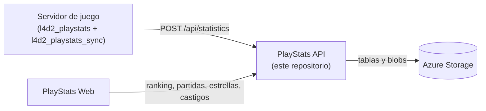

# API de datos de partidas de Left 4 Dead 2

🌐 [English](README.md) | [Português](README.pt.md) | **Español**

## Descripción general

Este proyecto es una aplicación Azure Functions v4 .NET isolated (net10.0) que almacena, procesa y sirve datos de partidas de Left 4 Dead 2. Los datos los genera el plugin [l4d2_playstats](https://github.com/SirPlease/L4D2-Competitive-Rework/blob/master/addons/sourcemod/plugins/optional/l4d2_playstats.smx).

El plugin [l4d2_playstats_sync](https://github.com/altair-sossai/l4d2-zone-server/blob/master/addons/sourcemod/scripting/l4d2_playstats_sync.sp) sube a esta API los archivos que escribe l4d2_playstats.

La API usa el paquete NuGet [L4D2PlayStats](https://www.nuget.org/packages/L4D2PlayStats) para convertir los archivos de l4d2_playstats en objetos C#. A partir de ellos construye las partidas, el ranking, las estadísticas de los jugadores y las estrellas de MVP.

## Contenido

- [Cómo encaja todo](#cómo-encaja-todo)
- [Requisitos](#requisitos)
- [Configuración](#configuración)
- [Almacenamiento](#almacenamiento)
- [Registrar un servidor](#registrar-un-servidor)
- [Ejecutar localmente](#ejecutar-localmente)
- [Ejecutar las pruebas](#ejecutar-las-pruebas)
- [Endpoints](#endpoints)
- [Tipos de datos](#tipos-de-datos)
- [Desplegar en Azure](#desplegar-en-azure)
- [Conectar el servidor de juego](#conectar-el-servidor-de-juego)
- [Conectar el sitio web](#conectar-el-sitio-web)
- [Comprobar que funciona](#comprobar-que-funciona)
- [Recursos adicionales](#recursos-adicionales)

## Cómo encaja todo



| Repositorio | Función |
|---|---|
| [l4d2-zone-server](https://github.com/altair-sossai/l4d2-zone-server) | Configuraciones del servidor de juego y plugins de SourceMod, incluido `l4d2_playstats_sync` |
| [l4d2-playstats-web](https://github.com/altair-sossai/l4d2-playstats-web) | Sitio que muestra el ranking, las partidas y las estrellas, y gestiona la tienda de skins de armas |

| Proyecto | Qué es |
|---|---|
| `L4D2PlayStats.FunctionApp` | La aplicación Azure Functions (funciones HTTP y de temporizador) |
| `L4D2PlayStats.Core` | Servicios, repositorios y reglas (partidas, ranking, estrellas, castigos, mix) |
| `tests/L4D2PlayStats.Tests` | Pruebas unitarias MSTest de `L4D2PlayStats.Core` |

## Requisitos

- [.NET 10 SDK](https://dotnet.microsoft.com/download/dotnet/10.0).
- [Azure Functions Core Tools](https://learn.microsoft.com/azure/azure-functions/functions-run-local) v4, para ejecutar la aplicación localmente (`func start`) y para publicarla.
- [Azurite](https://learn.microsoft.com/azure/storage/common/storage-use-azurite), el emulador local de Azure Storage (`npm install -g azurite`).
- [Azure Storage Explorer](https://azure.microsoft.com/products/storage/storage-explorer/) (opcional), para añadir servidores a la tabla `Servers` en Azurite o en Azure.
- Para desplegar: una suscripción de Azure y la [Azure CLI](https://learn.microsoft.com/cli/azure/install-azure-cli). Visual Studio 2022 o posterior con la carga de trabajo de desarrollo de Azure es opcional.

## Configuración

`L4D2PlayStats.FunctionApp/local.settings.json` está ignorado por git. Créalo para las ejecuciones locales. Los valores de abajo son para Azurite; nunca hagas commit de valores reales.

```json
{
  "IsEncrypted": false,
  "Values": {
    "AzureWebJobsStorage": "UseDevelopmentStorage=true",
    "FUNCTIONS_WORKER_RUNTIME": "dotnet-isolated"
  },
  "Host": {
    "LocalHttpPort": 7094,
    "CORS": "*"
  }
}
```

| Clave | Qué es |
|---|---|
| `AzureWebJobsStorage` | Cadena de conexión de Azure Storage. El host de Functions y la API la usan para todos sus datos (ver [Almacenamiento](#almacenamiento)). Usa `UseDevelopmentStorage=true` para Azurite |
| `FUNCTIONS_WORKER_RUNTIME` | Debe ser `dotnet-isolated` |
| `Host:LocalHttpPort` | Puerto local de `func start`. Los ejemplos de este README usan `7094` |
| `Host:CORS` | Orígenes permitidos en las ejecuciones locales |
| `ExperienceConfig:Win` | Opcional. Experiencia por victoria. Por defecto `85` |
| `ExperienceConfig:Loss` | Opcional. Experiencia por derrota. Por defecto `-80` |
| `ExperienceConfig:RageQuit` | Opcional. Experiencia por rage quit; reemplaza la experiencia de victoria, derrota y MVP de esa partida. Por defecto `-150` |
| `ExperienceConfig:Mvps` | Opcional. Experiencia por MVP de daño a infectados especiales. Por defecto `8` |
| `ExperienceConfig:MvpsCommon` | Opcional. Experiencia por MVP de infectados comunes. Por defecto `6` |

En local, las claves `ExperienceConfig` van en `Values`. En la configuración de la aplicación en Azure, escríbelas con doble guion bajo, por ejemplo `ExperienceConfig__Win`.

No hay otras configuraciones. Los servidores y sus secretos no son configuraciones: son filas de la tabla `Servers` (ver [Registrar un servidor](#registrar-un-servidor)).

> **Nunca apuntes `AzureWebJobsStorage` a una cuenta de almacenamiento de producción en tu máquina.** Las funciones de temporizador también se ejecutan en local: escriben blobs de ranking y de estrellas y pueden borrar todos los castigos de un servidor.

## Almacenamiento

Todo está en la cuenta de almacenamiento de `AzureWebJobsStorage`. Las tablas y los contenedores se crean automáticamente la primera vez que se usan.

| Tipo | Nombre | Contenido |
|---|---|---|
| Tabla | `Servers` | Servidores registrados: id, nombre visible, secreto y configuración del ranking. Se añaden a mano |
| Tabla | `Statistics` | Una fila por archivo subido. PartitionKey = id del servidor, RowKey = `long.MaxValue - ticks` de la fecha del archivo, para que las filas queden ordenadas de la más nueva a la más antigua |
| Tabla | `Punishments` | Puntos de experiencia quitados a los jugadores. PartitionKey = id del servidor, RowKey = SteamID64 |
| Contenedor de blobs | `{serverId}-ranking-history` | Rankings guardados: `ranking_yyyyMMyyyyMM.json` (periodos de dos meses), `ranking_yyyy.json` (años) y `ranking_all_time.json`. Se crea con **acceso público a los blobs** |
| Contenedor de blobs | `{serverId}-stars` | `closed_yyyyMM.json`: estrellas de MVP de todas las partidas anteriores al periodo de ranking actual. Privado |

Los nombres de los contenedores son el id del servidor en minúsculas más un sufijo. Usa ids de servidor formados por letras minúsculas, dígitos y guiones simples, de 47 caracteres como máximo, para que sean nombres de contenedor válidos.

## Registrar un servidor

Cada servidor de juego que sube datos, y cada cliente que llama a los endpoints autenticados, usa una fila de la tabla `Servers`:

| Propiedad | Valor |
|---|---|
| `PartitionKey` | Siempre `shared` |
| `RowKey` | El id del servidor, por ejemplo `my-server`. Es el `{serverId}` de las rutas |
| `DisplayName` | Nombre que devuelve `GET /api/servers` |
| `Secret` | Una cadena aleatoria larga, a tu elección |
| `ConfigurationName` | Una expresión regular de .NET. Solo las partidas cuyo nombre de configuración (el nombre de la config escrito en el archivo de l4d2_playstats) coincide con ella cuentan para el ranking, las estadísticas de los jugadores y las estrellas. Ejemplo: `^ZoneMod` |

Añade la fila con Azure Storage Explorer (Azurite aparece en *Emulator & Attached*) o con la Azure CLI:

```bash
az storage table create --name Servers --connection-string "<connection-string>"
az storage entity insert --table-name Servers --connection-string "<connection-string>" \
  --entity PartitionKey=shared RowKey=<serverId> DisplayName="<display name>" Secret=<secret> ConfigurationName="<regex>"
```

Los endpoints autenticados esperan la cabecera `Authorization: <serverId>:<secret>` (sin el prefijo `Bearer`). La API guarda la lista de servidores en memoria durante 10 minutos, así que un servidor nuevo o modificado puede tardar hasta 10 minutos en reconocerse (o reinicia la aplicación).

## Ejecutar localmente

1. Inicia Azurite: `azurite` (o `azurite --location <carpeta>` para guardar los datos en una carpeta).
2. Crea `L4D2PlayStats.FunctionApp/local.settings.json` como en [Configuración](#configuración).
3. Inicia la aplicación:

   ```bash
   cd L4D2PlayStats.FunctionApp
   func start
   ```

   Visual Studio o Rider también pueden ejecutar `L4D2PlayStats.FunctionApp`.
4. Abre `http://localhost:7094/api/ping`. Devuelve el id de la instancia y la hora del servidor.
5. Añade un servidor a la tabla `Servers` en Azurite (ver [Registrar un servidor](#registrar-un-servidor)) para subir datos y obtener resultados.

## Ejecutar las pruebas

```bash
dotnet test L4D2PlayStats.sln
```

Las pruebas cubren helpers y reglas de ranking de `L4D2PlayStats.Core` (conversión de SteamID, lectura del nombre de los archivos, periodos de ranking, resultados de partidas y rachas). No necesitan almacenamiento.

## Endpoints

Todas las rutas empiezan por `/api`. Todas las funciones HTTP usan el nivel de autorización `Anonymous`, así que no hace falta ninguna function key de Azure. Los endpoints de escritura comprueban, en su lugar, la cabecera `Authorization` del servidor.

### Públicos (GET)

| Ruta | Devuelve |
|---|---|
| `/api/ping` | Id de la instancia y hora del servidor |
| `/api/servers` | Todos los servidores (`id`, `displayName`) |
| `/api/servers/{serverId}` | Un servidor, o 404 |
| `/api/statistics/{serverId}` | Los 40 archivos más recientes del periodo de ranking actual, simplificados (caché de 5 minutos) |
| `/api/statistics/{serverId}/{statisticId}` | Un archivo con su contenido completo, o 404. `statisticId` es la RowKey |
| `/api/statistics/{serverId}/between/{start}/and/{end}` | Los archivos entre dos RowKeys, del más nuevo al más antiguo |
| `/api/matches/{serverId}?count=20` | Las primeras `count` partidas del periodo de ranking actual, competitivas o no |
| `/api/matches/{serverId}/year/{year}` | Todas las partidas de un año (UTC), competitivas o no |
| `/api/matches/{serverId}/between/{start}/and/{end}` | Las partidas construidas a partir de los archivos entre dos RowKeys, competitivas o no |
| `/api/ranking/{serverId}?count=100` | Ranking del periodo de ranking actual |
| `/api/ranking/{serverId}/last-match` | La última partida competitiva del periodo actual y la experiencia de sus jugadores, o 404 |
| `/api/ranking/{serverId}/place/{communityId}?count=100` | El top 3 y el jugador con ese SteamID64 (`top3`, `me`) |
| `/api/ranking/{serverId}/history` | Los rankings guardados (`id`, `fileName`, año y mes de inicio y de fin, y si es bimestral, anual o histórico) |
| `/api/ranking/{serverId}/history/{historyId}` | Un ranking guardado. `historyId` es `yyyyMMyyyyMM`, `yyyy` o `all_time`. Lista vacía si no existe |
| `/api/ranking-config` | Los valores de experiencia en uso (`ExperienceConfig`) |
| `/api/player-statistics/{serverId}` | Estadísticas por jugador en las partidas competitivas del periodo actual (caché de 1 hora) |
| `/api/stars/{serverId}` | Estrellas de MVP históricas de cada jugador (`communityId`, `mvpSiDamage`, `mvpCommon`, `stars`), de más a menos estrellas |
| `/api/stars/{serverId}/{communityId}` | Estrellas de MVP históricas de un jugador (ceros si no tiene ninguna) |

**Los periodos de ranking** duran dos meses, en UTC: ene–feb, mar–abr, may–jun, jul–ago, sep–oct y nov–dic. El ranking, las partidas, las estadísticas de los jugadores y la parte actual de las estrellas solo leen el periodo actual.

**`start` y `end`** en las rutas `between` son RowKeys, no fechas: `RowKey = long.MaxValue - date.Ticks` (UTC). Como el orden está invertido, `start` es la RowKey de la fecha **más nueva** y `end` la RowKey de la **más antigua**. El intervalo puede ser de 400 días como máximo.

**Una partida competitiva** tiene al menos dos mapas consecutivos de una campaña que la API conoce (`CampaignRepository`), es 4v4 y su nombre de configuración coincide con el `ConfigurationName` del servidor. Una estrella es un MVP (daño a infectados especiales o infectados comunes) en una partida competitiva.

### Autenticados (cabecera `Authorization: <serverId>:<secret>`)

| Método | Ruta | Cuerpo | Qué hace |
|---|---|---|---|
| POST | `/api/statistics` | `{ "fileName": "...", "content": "..." }` | Añade o actualiza un archivo. Devuelve `{ "fileName", "mustBeDeleted" }` |
| PUT | `/api/statistics/{statisticId}/update-score` | `{ "teamAScore": 0, "teamBScore": 0 }` | Cambia el marcador final de un archivo (de 0 a 10.000) |
| POST | `/api/mix?count=100` | `{ "player1": "<SteamID64>", ..., "player8": "<SteamID64>" }` | Divide 8 jugadores en dos equipos según su posición en el ranking (`survivors`, `infecteds`). Los 8 deben estar en el top `count` del ranking |
| POST | `/api/punishments` | `{ "communityId": "<SteamID64>", "lostExperiencePoints": 100 }` | Quita experiencia a un jugador. El valor debe ser mayor que 0 y se suma al castigo actual |
| DELETE | `/api/punishments/{communityId}` | — | Elimina el castigo de un jugador |

`fileName` debe tener el formato `yyyy-MM-dd_HH-mm_NNNN_<cualquier cosa>.txt` (los nombres que escribe l4d2_playstats). La fecha del nombre se convierte en la RowKey. Cuando un archivo no pasa la validación y su nombre no tiene fecha o tiene más de 12 horas, la API responde `mustBeDeleted: true` para que el plugin lo borre; en caso contrario, responde 400.

### Temporizadores

| Función | Programación (UTC por defecto) | Qué hace |
|---|---|---|
| `RankingFunction_SaveRankingAsync` | `0 0 0 * * *` (diario, 00:00) | Para cada servidor, guarda el ranking del periodo anterior y del año anterior si todavía no están guardados. Cuando guarda un nuevo ranking de periodo, también regenera `ranking_all_time.json` y **borra todos los castigos** de ese servidor |
| `StarsFunction_SaveClosedStarsAsync` | `0 30 0 * * *` (diario, 00:30) | Para cada servidor, se asegura de que exista el blob de estrellas cerradas del periodo actual |

### Errores

| Estado | Cuándo |
|---|---|
| 400 con `{ "statusCode", "message", "errors": [...] }` | Error de validación |
| 401 | Cabecera `Authorization` ausente o incorrecta |
| 400 sin cuerpo | Cualquier otro error, incluidos `fileName` o `content` no válidos |

Un `serverId` desconocido devuelve listas vacías, no 404.

## Tipos de datos

- **Statistics**: los archivos generados por el plugin l4d2_playstats, almacenados sin procesar.
- **Server**: los servidores registrados; varios servidores pueden usar la misma API.
- **Matches**: se construyen a partir de mapas consecutivos de la misma campaña. Los endpoints de partidas devuelven todas las partidas; cada una indica si es competitiva.
- **Ranking**: la experiencia de los jugadores en las partidas competitivas de un periodo, menos los castigos.
- **Mix**: dos equipos equilibrados para una nueva partida, basados en el ranking.
- **Stars**: MVPs de todo el historial, usados por la tienda de skins de armas del sitio web.
- **Punishments**: experiencia quitada a los jugadores, que se borra cuando se guarda un nuevo periodo de ranking.

## Desplegar en Azure

1. **Inicia sesión y crea un grupo de recursos**

   ```bash
   az login
   az group create --name <ResourceGroupName> --location <Location>
   ```

2. **Crea una cuenta de almacenamiento**

   ```bash
   az storage account create --name <StorageAccountName> --location <Location> --resource-group <ResourceGroupName> --sku Standard_LRS --allow-blob-public-access true
   ```

   `--allow-blob-public-access true` es necesario porque la API crea los contenedores `{serverId}-ranking-history` con acceso público a los blobs. Las cuentas de almacenamiento nuevas bloquean el acceso público por defecto, y la creación de esos contenedores fallaría.

3. **Crea la Function App**

   ```bash
   az functionapp create --name <FunctionAppName> --resource-group <ResourceGroupName> --storage-account <StorageAccountName> --consumption-plan-location <Location> --os-type Windows --runtime dotnet-isolated --runtime-version 10 --functions-version 4
   ```

   Esto configura `AzureWebJobsStorage` con la nueva cuenta de almacenamiento, así que los datos de la API se guardan en ella. Ejecuta `az functionapp list-runtimes --os windows` para comprobar que tu Azure CLI incluye `dotnet-isolated` versión 10.

4. **Opcional: cambia los valores de experiencia**

   ```bash
   az functionapp config appsettings set --name <FunctionAppName> --resource-group <ResourceGroupName> --settings ExperienceConfig__Win=85 ExperienceConfig__Loss=-80
   ```

5. **Publica**

   ```bash
   cd L4D2PlayStats.FunctionApp
   func azure functionapp publish <FunctionAppName>
   ```

   O, en Visual Studio, haz clic derecho en `L4D2PlayStats.FunctionApp`, elige **Publish** y sigue las instrucciones.

6. **Registra tu servidor** en la tabla `Servers` de la nueva cuenta de almacenamiento (ver [Registrar un servidor](#registrar-un-servidor)).

La API queda entonces en `https://<FunctionAppName>.azurewebsites.net/api/...`.

### Azure Pipelines

`azure-pipelines.yml` es un pipeline de Azure DevOps que se ejecuta en cada push a `main`. Instala el .NET 10 SDK, restaura y compila `L4D2PlayStats.FunctionApp` (Release), ejecuta `dotnet test`, publica la aplicación y la sube como el artefacto de build `function`. No tiene paso de despliegue ni service connection: el despliegue de ese artefacto en la Function App se hace fuera de este archivo, por ejemplo con un release pipeline que use la tarea `AzureFunctionApp` y tu propia service connection de Azure.

## Conectar el servidor de juego

Los plugins están en [l4d2-zone-server](https://github.com/altair-sossai/l4d2-zone-server), donde [docs/plugins](https://github.com/altair-sossai/l4d2-zone-server/blob/master/docs/plugins/README.md#l4d2_playstats_sync) documenta `l4d2_playstats_sync`. Necesita `l4d2_playstats` y la extensión RIPExt.

| ConVar | Valor | Dónde |
|---|---|---|
| `playstats_url` | URL base de la API, sin `/api` y sin barra final, por ejemplo `https://<FunctionAppName>.azurewebsites.net` | Un cfg versionado, por ejemplo `cfg/cfgogl/zonemod/shared_cvars.cfg` |
| `playstats_access_token` | `<serverId>:<secret>` de tu fila en `Servers` | `cfg/server_secrets.cfg` (ignorado por git), por ejemplo `sm_cvar playstats_access_token "<serverId>:<secret>"` |

Diez segundos después de que empiece cada ronda, el plugin envía todos los archivos de l4d2_playstats de `addons/sourcemod/logs/` a `POST /api/statistics` y borra los que la API marca con `mustBeDeleted`. Después de cada subida también llama a `{ranking_url}/api/cache/clear` en el sitio web (`ranking_url` pertenece al plugin `l4d2_ranking`, no a esta API).

## Conectar el sitio web

[l4d2-playstats-web](https://github.com/altair-sossai/l4d2-playstats-web#configuration) lee la API con estas claves de su `appsettings.json`:

| Clave | Valor |
|---|---|
| `ServerId` | El id de tu servidor (`RowKey` de la fila en `Servers`) |
| `PlayStatsApiUrl` | URL base de la API, por ejemplo `https://<FunctionAppName>.azurewebsites.net` |
| `PlayStatsSecret` | El `Secret` de ese servidor |

El sitio envía `Authorization: <ServerId>:<PlayStatsSecret>` en todas las llamadas. Usa los endpoints de partidas, ranking, estadísticas, castigos y estrellas.

## Comprobar que funciona

1. `GET /api/ping` devuelve un id de instancia y una hora.
2. `GET /api/servers` lista tu servidor.
3. Cuando termina un mapa y empieza la siguiente ronda en el servidor de juego, la tabla `Statistics` tiene filas nuevas y `GET /api/statistics/{serverId}` lista los archivos.
4. Después de una partida competitiva (al menos dos mapas, 4v4, configuración que coincide con `ConfigurationName`), `GET /api/ranking/{serverId}` y `GET /api/stars/{serverId}` listan los jugadores.

Si las subidas fallan, comprueba que `playstats_access_token` sea exactamente `<serverId>:<secret>` (un 401 significa que no coincide con ninguna fila de `Servers`) y recuerda la caché de 10 minutos de los servidores.

## Recursos adicionales

- [Documentación de Azure Functions](https://learn.microsoft.com/azure/azure-functions/)
- [Documentación de las cuentas de Azure Storage](https://learn.microsoft.com/azure/storage/common/storage-account-overview)
- [Paquete NuGet L4D2PlayStats](https://www.nuget.org/packages/L4D2PlayStats)
- [Wiki de las skins de armas: estrellas](https://github.com/altair-sossai/l4d2-zone-server/blob/master/docs/weapon-skins/04-stars-api.es.md), cómo se calculan las estrellas
