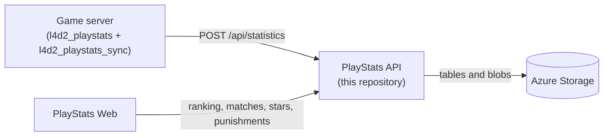

# Left 4 Dead 2 Match Data API

🌐 **English** | [Português](README.pt.md) | [Español](README.es.md)

## Overview

This project is an Azure Functions v4 .NET isolated (net10.0) application that stores, processes and serves data from Left 4 Dead 2 matches. The data is generated by the [l4d2_playstats](https://github.com/SirPlease/L4D2-Competitive-Rework/blob/master/addons/sourcemod/plugins/optional/l4d2_playstats.smx) plugin.

The [l4d2_playstats_sync](https://github.com/altair-sossai/l4d2-zone-server/blob/master/addons/sourcemod/scripting/l4d2_playstats_sync.sp) plugin uploads the files written by l4d2_playstats to this API.

The API uses the [L4D2PlayStats](https://www.nuget.org/packages/L4D2PlayStats) NuGet package to parse the l4d2_playstats files into C# objects. From them it builds matches, the ranking, player statistics and the MVP stars.

## Contents

- [How it fits together](#how-it-fits-together)
- [Requirements](#requirements)
- [Configuration](#configuration)
- [Storage](#storage)
- [Registering a server](#registering-a-server)
- [Running locally](#running-locally)
- [Running the tests](#running-the-tests)
- [Endpoints](#endpoints)
- [Data types](#data-types)
- [Deploying to Azure](#deploying-to-azure)
- [Connecting the game server](#connecting-the-game-server)
- [Connecting the web site](#connecting-the-web-site)
- [Checking that it works](#checking-that-it-works)
- [Additional resources](#additional-resources)

## How it fits together



| Repository | Role |
|---|---|
| [l4d2-zone-server](https://github.com/altair-sossai/l4d2-zone-server) | Game server configs and SourceMod plugins, including `l4d2_playstats_sync` |
| [l4d2-playstats-web](https://github.com/altair-sossai/l4d2-playstats-web) | Site that shows the ranking, matches and stars, and runs the weapon skin shop |

| Project | What it is |
|---|---|
| `L4D2PlayStats.FunctionApp` | The Azure Functions app (HTTP and timer functions) |
| `L4D2PlayStats.Core` | Services, repositories and rules (matches, ranking, stars, punishments, mix) |
| `tests/L4D2PlayStats.Tests` | MSTest unit tests for `L4D2PlayStats.Core` |

## Requirements

- [.NET 10 SDK](https://dotnet.microsoft.com/download/dotnet/10.0).
- [Azure Functions Core Tools](https://learn.microsoft.com/azure/azure-functions/functions-run-local) v4, to run the app locally (`func start`) and to publish it.
- [Azurite](https://learn.microsoft.com/azure/storage/common/storage-use-azurite), the local Azure Storage emulator (`npm install -g azurite`).
- [Azure Storage Explorer](https://azure.microsoft.com/products/storage/storage-explorer/) (optional), to add servers to the `Servers` table in Azurite or in Azure.
- For deployment: an Azure subscription and the [Azure CLI](https://learn.microsoft.com/cli/azure/install-azure-cli). Visual Studio 2022 or later with the Azure development workload is optional.

## Configuration

`L4D2PlayStats.FunctionApp/local.settings.json` is ignored by git. Create it for local runs. The values below are for Azurite; never commit real values.

```json
{
  "IsEncrypted": false,
  "Values": {
    "AzureWebJobsStorage": "UseDevelopmentStorage=true",
    "FUNCTIONS_WORKER_RUNTIME": "dotnet-isolated"
  },
  "Host": {
    "LocalHttpPort": 7094,
    "CORS": "*"
  }
}
```

| Key | What it is |
|---|---|
| `AzureWebJobsStorage` | Azure Storage connection string. The Functions host and the API use it for all their data (see [Storage](#storage)). Use `UseDevelopmentStorage=true` for Azurite |
| `FUNCTIONS_WORKER_RUNTIME` | Must be `dotnet-isolated` |
| `Host:LocalHttpPort` | Local port of `func start`. The examples in this README use `7094` |
| `Host:CORS` | Allowed origins for local runs |
| `ExperienceConfig:Win` | Optional. Experience for a win. Default `85` |
| `ExperienceConfig:Loss` | Optional. Experience for a loss. Default `-80` |
| `ExperienceConfig:RageQuit` | Optional. Experience for a rage quit; it replaces the win, loss and MVP experience of that match. Default `-150` |
| `ExperienceConfig:Mvps` | Optional. Experience per special infected damage MVP. Default `8` |
| `ExperienceConfig:MvpsCommon` | Optional. Experience per common infected MVP. Default `6` |

The `ExperienceConfig` keys go in `Values` locally. In Azure app settings, write them with a double underscore, for example `ExperienceConfig__Win`.

There are no other settings. The servers and their secrets are not settings: they are rows of the `Servers` table (see [Registering a server](#registering-a-server)).

> **Never point `AzureWebJobsStorage` at a production storage account on your machine.** The timer functions also run locally: they write ranking and stars blobs and can delete every punishment of a server.

## Storage

Everything lives in the storage account of `AzureWebJobsStorage`. Tables and containers are created automatically when first used.

| Kind | Name | Content |
|---|---|---|
| Table | `Servers` | Registered servers: id, display name, secret and ranking configuration. Added by hand |
| Table | `Statistics` | One row per uploaded file. PartitionKey = server id, RowKey = `long.MaxValue - ticks` of the file date, so rows sort newest first |
| Table | `Punishments` | Experience points taken from players. PartitionKey = server id, RowKey = SteamID64 |
| Blob container | `{serverId}-ranking-history` | Saved rankings: `ranking_yyyyMMyyyyMM.json` (two-month periods), `ranking_yyyy.json` (years) and `ranking_all_time.json`. Created with **public blob access** |
| Blob container | `{serverId}-stars` | `closed_yyyyMM.json`: MVP stars of every match before the current ranking period. Private |

Container names are the server id in lower case plus a suffix. Use server ids made of lower case letters, digits and single hyphens, at most 47 characters, so they are valid container names.

## Registering a server

Every game server that uploads data, and every client that calls the authenticated endpoints, uses a row of the `Servers` table:

| Property | Value |
|---|---|
| `PartitionKey` | Always `shared` |
| `RowKey` | The server id, e.g. `my-server`. This is the `{serverId}` in the routes |
| `DisplayName` | Name returned by `GET /api/servers` |
| `Secret` | A long random string of your choice |
| `ConfigurationName` | A .NET regular expression. Only matches whose configuration name (the config name written in the l4d2_playstats file) matches it count for the ranking, player statistics and stars. Example: `^ZoneMod` |

Add the row with Azure Storage Explorer (Azurite appears under *Emulator & Attached*), or with the Azure CLI:

```bash
az storage table create --name Servers --connection-string "<connection-string>"
az storage entity insert --table-name Servers --connection-string "<connection-string>" \
  --entity PartitionKey=shared RowKey=<serverId> DisplayName="<display name>" Secret=<secret> ConfigurationName="<regex>"
```

Authenticated endpoints expect the header `Authorization: <serverId>:<secret>` (no `Bearer` prefix). The API keeps the server list in memory for 10 minutes, so a new or changed server can take up to 10 minutes to be seen (or restart the app).

## Running locally

1. Start Azurite: `azurite` (or `azurite --location <folder>` to keep the data in a folder).
2. Create `L4D2PlayStats.FunctionApp/local.settings.json` as in [Configuration](#configuration).
3. Start the app:

   ```bash
   cd L4D2PlayStats.FunctionApp
   func start
   ```

   Visual Studio or Rider can run `L4D2PlayStats.FunctionApp` too.
4. Open `http://localhost:7094/api/ping`. It returns the instance id and the server time.
5. Add a server to the `Servers` table in Azurite (see [Registering a server](#registering-a-server)) to upload data and get results.

## Running the tests

```bash
dotnet test L4D2PlayStats.sln
```

The tests cover `L4D2PlayStats.Core` helpers and ranking rules (SteamID conversion, file name parsing, ranking periods, match results and streaks). They do not need storage.

## Endpoints

All routes start with `/api`. Every HTTP function uses the `Anonymous` authorization level, so no Azure function key is needed. The write endpoints check the server `Authorization` header instead.

### Public (GET)

| Route | Returns |
|---|---|
| `/api/ping` | Instance id and server time |
| `/api/servers` | All servers (`id`, `displayName`) |
| `/api/servers/{serverId}` | One server, or 404 |
| `/api/statistics/{serverId}` | The 40 most recent files of the current ranking period, simplified (cached for 5 minutes) |
| `/api/statistics/{serverId}/{statisticId}` | One file with its full content, or 404. `statisticId` is the RowKey |
| `/api/statistics/{serverId}/between/{start}/and/{end}` | The files between two RowKeys, newest first |
| `/api/matches/{serverId}?count=20` | The first `count` matches of the current ranking period, competitive or not |
| `/api/matches/{serverId}/year/{year}` | All matches of a year (UTC), competitive or not |
| `/api/matches/{serverId}/between/{start}/and/{end}` | The matches built from the files between two RowKeys, competitive or not |
| `/api/ranking/{serverId}?count=100` | Ranking of the current ranking period |
| `/api/ranking/{serverId}/last-match` | The last competitive match of the current period and the experience of its players, or 404 |
| `/api/ranking/{serverId}/place/{communityId}?count=100` | The top 3 and the player with that SteamID64 (`top3`, `me`) |
| `/api/ranking/{serverId}/history` | The saved rankings (`id`, `fileName`, start and end year and month, and whether it is two-month, annual or all time) |
| `/api/ranking/{serverId}/history/{historyId}` | One saved ranking. `historyId` is `yyyyMMyyyyMM`, `yyyy` or `all_time`. Empty list if it does not exist |
| `/api/ranking-config` | The experience values in use (`ExperienceConfig`) |
| `/api/player-statistics/{serverId}` | Statistics per player over the competitive matches of the current period (cached for 1 hour) |
| `/api/stars/{serverId}` | All-time MVP stars of every player (`communityId`, `mvpSiDamage`, `mvpCommon`, `stars`), most stars first |
| `/api/stars/{serverId}/{communityId}` | All-time MVP stars of one player (zeros if the player has none) |

**Ranking periods** are two months long, in UTC: Jan–Feb, Mar–Apr, May–Jun, Jul–Aug, Sep–Oct and Nov–Dec. The ranking, the matches, the player statistics and the current part of the stars only read the current period.

**`start` and `end`** in the `between` routes are RowKeys, not dates: `RowKey = long.MaxValue - date.Ticks` (UTC). Because the order is inverted, `start` is the RowKey of the **newest** date and `end` the RowKey of the **oldest**. The range can be at most 400 days.

**A competitive match** has at least two consecutive maps of a campaign the API knows (`CampaignRepository`), is 4v4, and its configuration name matches the server's `ConfigurationName`. One star is one MVP (special infected damage or common infected) in a competitive match.

### Authenticated (header `Authorization: <serverId>:<secret>`)

| Method | Route | Body | What it does |
|---|---|---|---|
| POST | `/api/statistics` | `{ "fileName": "...", "content": "..." }` | Adds or updates a file. Returns `{ "fileName", "mustBeDeleted" }` |
| PUT | `/api/statistics/{statisticId}/update-score` | `{ "teamAScore": 0, "teamBScore": 0 }` | Changes the final score of a file (0 to 10,000) |
| POST | `/api/mix?count=100` | `{ "player1": "<SteamID64>", ..., "player8": "<SteamID64>" }` | Splits 8 players into two teams by ranking position (`survivors`, `infecteds`). All 8 must be in the top `count` of the ranking |
| POST | `/api/punishments` | `{ "communityId": "<SteamID64>", "lostExperiencePoints": 100 }` | Takes experience from a player. The value must be greater than 0 and is added to the current punishment |
| DELETE | `/api/punishments/{communityId}` | — | Removes the punishment of a player |

`fileName` must look like `yyyy-MM-dd_HH-mm_NNNN_<anything>.txt` (the names written by l4d2_playstats). The date in the name becomes the RowKey. When a file fails validation and its name has no date or is older than 12 hours, the API answers `mustBeDeleted: true` so the plugin deletes it; otherwise it answers 400.

### Timers

| Function | Schedule (UTC by default) | What it does |
|---|---|---|
| `RankingFunction_SaveRankingAsync` | `0 0 0 * * *` (daily, 00:00) | For each server, saves the ranking of the previous period and of the previous year if they are not saved yet. When a new period ranking is saved, it also rebuilds `ranking_all_time.json` and **deletes all punishments** of that server |
| `StarsFunction_SaveClosedStarsAsync` | `0 30 0 * * *` (daily, 00:30) | For each server, makes sure the closed stars blob of the current period exists |

### Errors

| Status | When |
|---|---|
| 400 with `{ "statusCode", "message", "errors": [...] }` | Validation error |
| 401 | Missing or wrong `Authorization` header |
| 400 with no body | Any other error, including an invalid `fileName` or `content` |

An unknown `serverId` returns empty lists, not 404.

## Data types

- **Statistics**: the files generated by the l4d2_playstats plugin, stored without processing.
- **Server**: the registered servers; several servers can use the same API.
- **Matches**: built from consecutive maps of the same campaign. The matches endpoints return every match; each one says whether it is competitive.
- **Ranking**: player experience over the competitive matches of a period, minus the punishments.
- **Mix**: two balanced teams for a new game, based on the ranking.
- **Stars**: MVPs over the whole history, used by the weapon skin shop of the web site.
- **Punishments**: experience taken from players, cleared when a new ranking period is saved.

## Deploying to Azure

1. **Log in and create a resource group**

   ```bash
   az login
   az group create --name <ResourceGroupName> --location <Location>
   ```

2. **Create a storage account**

   ```bash
   az storage account create --name <StorageAccountName> --location <Location> --resource-group <ResourceGroupName> --sku Standard_LRS --allow-blob-public-access true
   ```

   `--allow-blob-public-access true` is needed because the API creates the `{serverId}-ranking-history` containers with public blob access. New storage accounts block public access by default, and creating those containers would fail.

3. **Create the Function App**

   ```bash
   az functionapp create --name <FunctionAppName> --resource-group <ResourceGroupName> --storage-account <StorageAccountName> --consumption-plan-location <Location> --os-type Windows --runtime dotnet-isolated --runtime-version 10 --functions-version 4
   ```

   This sets `AzureWebJobsStorage` to the new storage account, so the API data goes there. Run `az functionapp list-runtimes --os windows` to check that your Azure CLI lists `dotnet-isolated` version 10.

4. **Optional: change the experience values**

   ```bash
   az functionapp config appsettings set --name <FunctionAppName> --resource-group <ResourceGroupName> --settings ExperienceConfig__Win=85 ExperienceConfig__Loss=-80
   ```

5. **Publish**

   ```bash
   cd L4D2PlayStats.FunctionApp
   func azure functionapp publish <FunctionAppName>
   ```

   Or, in Visual Studio, right-click `L4D2PlayStats.FunctionApp`, select **Publish** and follow the prompts.

6. **Register your server** in the `Servers` table of the new storage account (see [Registering a server](#registering-a-server)).

The API is then at `https://<FunctionAppName>.azurewebsites.net/api/...`.

### Azure Pipelines

`azure-pipelines.yml` is an Azure DevOps pipeline that runs on every push to `main`. It installs the .NET 10 SDK, restores and builds `L4D2PlayStats.FunctionApp` (Release), runs `dotnet test`, publishes the app and uploads it as the build artifact `function`. It has no deploy step and no service connection: deploying that artifact to the Function App happens outside this file, for example in a release pipeline that uses the `AzureFunctionApp` task and your own Azure service connection.

## Connecting the game server

The plugins live in [l4d2-zone-server](https://github.com/altair-sossai/l4d2-zone-server), where [docs/plugins](https://github.com/altair-sossai/l4d2-zone-server/blob/master/docs/plugins/README.md#l4d2_playstats_sync) documents `l4d2_playstats_sync`. It needs `l4d2_playstats` and the RIPExt extension.

| ConVar | Value | Where |
|---|---|---|
| `playstats_url` | Base URL of the API, without `/api` and without a trailing slash, e.g. `https://<FunctionAppName>.azurewebsites.net` | A versioned cfg, e.g. `cfg/cfgogl/zonemod/shared_cvars.cfg` |
| `playstats_access_token` | `<serverId>:<secret>` of your `Servers` row | `cfg/server_secrets.cfg` (git-ignored), e.g. `sm_cvar playstats_access_token "<serverId>:<secret>"` |

Ten seconds after each round starts, the plugin sends every l4d2_playstats file in `addons/sourcemod/logs/` to `POST /api/statistics` and deletes the ones the API marks with `mustBeDeleted`. After each upload it also calls `{ranking_url}/api/cache/clear` on the web site (`ranking_url` belongs to the `l4d2_ranking` plugin, not to this API).

## Connecting the web site

[l4d2-playstats-web](https://github.com/altair-sossai/l4d2-playstats-web#configuration) reads the API with these keys of its `appsettings.json`:

| Key | Value |
|---|---|
| `ServerId` | Your server id (`RowKey` of the `Servers` row) |
| `PlayStatsApiUrl` | Base URL of the API, e.g. `https://<FunctionAppName>.azurewebsites.net` |
| `PlayStatsSecret` | The `Secret` of that server |

The site sends `Authorization: <ServerId>:<PlayStatsSecret>` on every call. It uses the matches, ranking, statistics, punishments and stars endpoints.

## Checking that it works

1. `GET /api/ping` returns an instance id and a time.
2. `GET /api/servers` lists your server.
3. After a map ends and the next round starts on the game server, the `Statistics` table has new rows and `GET /api/statistics/{serverId}` lists the files.
4. After a competitive match (at least two maps, 4v4, configuration matching `ConfigurationName`), `GET /api/ranking/{serverId}` and `GET /api/stars/{serverId}` list the players.

If uploads fail, check that `playstats_access_token` is exactly `<serverId>:<secret>` (a 401 means it does not match a `Servers` row) and remember the 10-minute server cache.

## Additional resources

- [Azure Functions documentation](https://learn.microsoft.com/azure/azure-functions/)
- [Azure Storage account documentation](https://learn.microsoft.com/azure/storage/common/storage-account-overview)
- [L4D2PlayStats NuGet package](https://www.nuget.org/packages/L4D2PlayStats)
- [Weapon skins wiki: stars](https://github.com/altair-sossai/l4d2-zone-server/blob/master/docs/weapon-skins/04-stars-api.md), how the stars are computed
