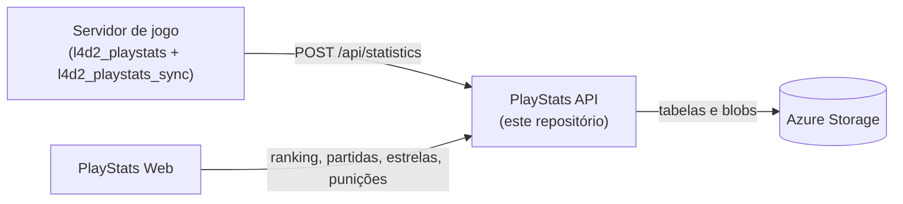

# API de dados de partidas do Left 4 Dead 2

🌐 [English](README.md) | **Português** | [Español](README.es.md)

## Visão geral

Este projeto é uma aplicação Azure Functions v4 .NET isolated (net10.0) que armazena, processa e disponibiliza dados de partidas de Left 4 Dead 2. Os dados são gerados pelo plugin [l4d2_playstats](https://github.com/SirPlease/L4D2-Competitive-Rework/blob/master/addons/sourcemod/plugins/optional/l4d2_playstats.smx).

O plugin [l4d2_playstats_sync](https://github.com/altair-sossai/l4d2-zone-server/blob/master/addons/sourcemod/scripting/l4d2_playstats_sync.sp) envia para esta API os arquivos gravados pelo l4d2_playstats.

A API usa o pacote NuGet [L4D2PlayStats](https://www.nuget.org/packages/L4D2PlayStats) para converter os arquivos do l4d2_playstats em objetos C#. A partir deles, monta as partidas, o ranking, as estatísticas dos jogadores e as estrelas de MVP.

## Conteúdo

- [Como tudo se encaixa](#como-tudo-se-encaixa)
- [Requisitos](#requisitos)
- [Configuração](#configuração)
- [Armazenamento](#armazenamento)
- [Registrando um servidor](#registrando-um-servidor)
- [Executando localmente](#executando-localmente)
- [Executando os testes](#executando-os-testes)
- [Endpoints](#endpoints)
- [Tipos de dados](#tipos-de-dados)
- [Publicando no Azure](#publicando-no-azure)
- [Conectando o servidor de jogo](#conectando-o-servidor-de-jogo)
- [Conectando o site](#conectando-o-site)
- [Verificando se funciona](#verificando-se-funciona)
- [Recursos adicionais](#recursos-adicionais)

## Como tudo se encaixa



| Repositório | Papel |
|---|---|
| [l4d2-zone-server](https://github.com/altair-sossai/l4d2-zone-server) | Configurações do servidor de jogo e plugins SourceMod, incluindo o `l4d2_playstats_sync` |
| [l4d2-playstats-web](https://github.com/altair-sossai/l4d2-playstats-web) | Site que mostra o ranking, as partidas e as estrelas, e mantém a loja de skins de armas |

| Projeto | O que é |
|---|---|
| `L4D2PlayStats.FunctionApp` | A aplicação Azure Functions (funções HTTP e de timer) |
| `L4D2PlayStats.Core` | Serviços, repositórios e regras (partidas, ranking, estrelas, punições, mix) |
| `tests/L4D2PlayStats.Tests` | Testes unitários MSTest do `L4D2PlayStats.Core` |

## Requisitos

- [.NET 10 SDK](https://dotnet.microsoft.com/download/dotnet/10.0).
- [Azure Functions Core Tools](https://learn.microsoft.com/azure/azure-functions/functions-run-local) v4, para executar a aplicação localmente (`func start`) e para publicá-la.
- [Azurite](https://learn.microsoft.com/azure/storage/common/storage-use-azurite), o emulador local do Azure Storage (`npm install -g azurite`).
- [Azure Storage Explorer](https://azure.microsoft.com/products/storage/storage-explorer/) (opcional), para adicionar servidores à tabela `Servers` no Azurite ou no Azure.
- Para publicar: uma assinatura do Azure e a [Azure CLI](https://learn.microsoft.com/cli/azure/install-azure-cli). O Visual Studio 2022 ou mais recente com a carga de trabalho de desenvolvimento do Azure é opcional.

## Configuração

O `L4D2PlayStats.FunctionApp/local.settings.json` é ignorado pelo git. Crie-o para as execuções locais. Os valores abaixo são para o Azurite; nunca faça commit de valores reais.

```json
{
  "IsEncrypted": false,
  "Values": {
    "AzureWebJobsStorage": "UseDevelopmentStorage=true",
    "FUNCTIONS_WORKER_RUNTIME": "dotnet-isolated"
  },
  "Host": {
    "LocalHttpPort": 7094,
    "CORS": "*"
  }
}
```

| Chave | O que é |
|---|---|
| `AzureWebJobsStorage` | Connection string do Azure Storage. O host do Functions e a API a usam para todos os seus dados (veja [Armazenamento](#armazenamento)). Use `UseDevelopmentStorage=true` para o Azurite |
| `FUNCTIONS_WORKER_RUNTIME` | Deve ser `dotnet-isolated` |
| `Host:LocalHttpPort` | Porta local do `func start`. Os exemplos deste README usam `7094` |
| `Host:CORS` | Origens permitidas nas execuções locais |
| `ExperienceConfig:Win` | Opcional. Experiência por vitória. Padrão `85` |
| `ExperienceConfig:Loss` | Opcional. Experiência por derrota. Padrão `-80` |
| `ExperienceConfig:RageQuit` | Opcional. Experiência por rage quit; substitui a experiência de vitória, derrota e MVP daquela partida. Padrão `-150` |
| `ExperienceConfig:Mvps` | Opcional. Experiência por MVP de dano em infectados especiais. Padrão `8` |
| `ExperienceConfig:MvpsCommon` | Opcional. Experiência por MVP de infectados comuns. Padrão `6` |

Localmente, as chaves `ExperienceConfig` ficam em `Values`. Nas configurações de aplicativo do Azure, escreva-as com dois sublinhados, por exemplo `ExperienceConfig__Win`.

Não há outras configurações. Os servidores e seus segredos não são configurações: são linhas da tabela `Servers` (veja [Registrando um servidor](#registrando-um-servidor)).

> **Nunca aponte o `AzureWebJobsStorage` para uma conta de armazenamento de produção na sua máquina.** As funções de timer também rodam localmente: elas gravam blobs de ranking e de estrelas e podem apagar todas as punições de um servidor.

## Armazenamento

Tudo fica na conta de armazenamento do `AzureWebJobsStorage`. As tabelas e os contêineres são criados automaticamente no primeiro uso.

| Tipo | Nome | Conteúdo |
|---|---|---|
| Tabela | `Servers` | Servidores registrados: id, nome de exibição, segredo e configuração do ranking. Adicionados à mão |
| Tabela | `Statistics` | Uma linha por arquivo enviado. PartitionKey = id do servidor, RowKey = `long.MaxValue - ticks` da data do arquivo, para que as linhas fiquem ordenadas da mais nova para a mais antiga |
| Tabela | `Punishments` | Pontos de experiência retirados dos jogadores. PartitionKey = id do servidor, RowKey = SteamID64 |
| Contêiner de blobs | `{serverId}-ranking-history` | Rankings salvos: `ranking_yyyyMMyyyyMM.json` (períodos de dois meses), `ranking_yyyy.json` (anos) e `ranking_all_time.json`. Criado com **acesso público aos blobs** |
| Contêiner de blobs | `{serverId}-stars` | `closed_yyyyMM.json`: estrelas de MVP de todas as partidas anteriores ao período de ranking atual. Privado |

Os nomes dos contêineres são o id do servidor em minúsculas mais um sufixo. Use ids de servidor formados por letras minúsculas, dígitos e hífens simples, com no máximo 47 caracteres, para que sejam nomes de contêiner válidos.

## Registrando um servidor

Cada servidor de jogo que envia dados, e cada cliente que chama os endpoints autenticados, usa uma linha da tabela `Servers`:

| Propriedade | Valor |
|---|---|
| `PartitionKey` | Sempre `shared` |
| `RowKey` | O id do servidor, por exemplo `my-server`. É o `{serverId}` das rotas |
| `DisplayName` | Nome retornado por `GET /api/servers` |
| `Secret` | Uma string aleatória longa, à sua escolha |
| `ConfigurationName` | Uma expressão regular .NET. Só as partidas cujo nome de configuração (o nome da config gravado no arquivo do l4d2_playstats) corresponde a ela contam para o ranking, as estatísticas dos jogadores e as estrelas. Exemplo: `^ZoneMod` |

Adicione a linha com o Azure Storage Explorer (o Azurite aparece em *Emulator & Attached*) ou com a Azure CLI:

```bash
az storage table create --name Servers --connection-string "<connection-string>"
az storage entity insert --table-name Servers --connection-string "<connection-string>" \
  --entity PartitionKey=shared RowKey=<serverId> DisplayName="<display name>" Secret=<secret> ConfigurationName="<regex>"
```

Os endpoints autenticados esperam o cabeçalho `Authorization: <serverId>:<secret>` (sem o prefixo `Bearer`). A API guarda a lista de servidores em memória por 10 minutos, então um servidor novo ou alterado pode levar até 10 minutos para ser reconhecido (ou reinicie a aplicação).

## Executando localmente

1. Inicie o Azurite: `azurite` (ou `azurite --location <pasta>` para guardar os dados numa pasta).
2. Crie o `L4D2PlayStats.FunctionApp/local.settings.json` como em [Configuração](#configuração).
3. Inicie a aplicação:

   ```bash
   cd L4D2PlayStats.FunctionApp
   func start
   ```

   O Visual Studio ou o Rider também podem executar o `L4D2PlayStats.FunctionApp`.
4. Abra `http://localhost:7094/api/ping`. Ele retorna o id da instância e a hora do servidor.
5. Adicione um servidor à tabela `Servers` no Azurite (veja [Registrando um servidor](#registrando-um-servidor)) para enviar dados e obter resultados.

## Executando os testes

```bash
dotnet test L4D2PlayStats.sln
```

Os testes cobrem helpers e regras de ranking do `L4D2PlayStats.Core` (conversão de SteamID, leitura do nome dos arquivos, períodos de ranking, resultados de partidas e sequências). Eles não precisam de armazenamento.

## Endpoints

Todas as rotas começam com `/api`. Todas as funções HTTP usam o nível de autorização `Anonymous`, então nenhuma function key do Azure é necessária. Os endpoints de escrita verificam, no lugar dela, o cabeçalho `Authorization` do servidor.

### Públicos (GET)

| Rota | Retorna |
|---|---|
| `/api/ping` | Id da instância e hora do servidor |
| `/api/servers` | Todos os servidores (`id`, `displayName`) |
| `/api/servers/{serverId}` | Um servidor, ou 404 |
| `/api/statistics/{serverId}` | Os 40 arquivos mais recentes do período de ranking atual, simplificados (cache de 5 minutos) |
| `/api/statistics/{serverId}/{statisticId}` | Um arquivo com o conteúdo completo, ou 404. `statisticId` é a RowKey |
| `/api/statistics/{serverId}/between/{start}/and/{end}` | Os arquivos entre duas RowKeys, do mais novo para o mais antigo |
| `/api/matches/{serverId}?count=20` | As primeiras `count` partidas do período de ranking atual, competitivas ou não |
| `/api/matches/{serverId}/year/{year}` | Todas as partidas de um ano (UTC), competitivas ou não |
| `/api/matches/{serverId}/between/{start}/and/{end}` | As partidas montadas a partir dos arquivos entre duas RowKeys, competitivas ou não |
| `/api/ranking/{serverId}?count=100` | Ranking do período de ranking atual |
| `/api/ranking/{serverId}/last-match` | A última partida competitiva do período atual e a experiência dos seus jogadores, ou 404 |
| `/api/ranking/{serverId}/place/{communityId}?count=100` | O top 3 e o jogador com aquele SteamID64 (`top3`, `me`) |
| `/api/ranking/{serverId}/history` | Os rankings salvos (`id`, `fileName`, ano e mês de início e de fim, e se é bimestral, anual ou de todos os tempos) |
| `/api/ranking/{serverId}/history/{historyId}` | Um ranking salvo. `historyId` é `yyyyMMyyyyMM`, `yyyy` ou `all_time`. Lista vazia se não existir |
| `/api/ranking-config` | Os valores de experiência em uso (`ExperienceConfig`) |
| `/api/player-statistics/{serverId}` | Estatísticas por jogador nas partidas competitivas do período atual (cache de 1 hora) |
| `/api/stars/{serverId}` | Estrelas de MVP de todos os tempos de cada jogador (`communityId`, `mvpSiDamage`, `mvpCommon`, `stars`), da maior para a menor quantidade |
| `/api/stars/{serverId}/{communityId}` | Estrelas de MVP de todos os tempos de um jogador (zeros se o jogador não tiver nenhuma) |

**Os períodos de ranking** duram dois meses, em UTC: jan–fev, mar–abr, mai–jun, jul–ago, set–out e nov–dez. O ranking, as partidas, as estatísticas dos jogadores e a parte atual das estrelas só leem o período atual.

**`start` e `end`** nas rotas `between` são RowKeys, não datas: `RowKey = long.MaxValue - date.Ticks` (UTC). Como a ordem é invertida, `start` é a RowKey da data **mais nova** e `end` a RowKey da **mais antiga**. O intervalo pode ter no máximo 400 dias.

**Uma partida competitiva** tem pelo menos dois mapas consecutivos de uma campanha que a API conhece (`CampaignRepository`), é 4v4 e o seu nome de configuração corresponde ao `ConfigurationName` do servidor. Uma estrela é um MVP (dano em infectados especiais ou infectados comuns) numa partida competitiva.

### Autenticados (cabeçalho `Authorization: <serverId>:<secret>`)

| Método | Rota | Corpo | O que faz |
|---|---|---|---|
| POST | `/api/statistics` | `{ "fileName": "...", "content": "..." }` | Adiciona ou atualiza um arquivo. Retorna `{ "fileName", "mustBeDeleted" }` |
| PUT | `/api/statistics/{statisticId}/update-score` | `{ "teamAScore": 0, "teamBScore": 0 }` | Altera o placar final de um arquivo (de 0 a 10.000) |
| POST | `/api/mix?count=100` | `{ "player1": "<SteamID64>", ..., "player8": "<SteamID64>" }` | Divide 8 jogadores em dois times pela posição no ranking (`survivors`, `infecteds`). Os 8 precisam estar no top `count` do ranking |
| POST | `/api/punishments` | `{ "communityId": "<SteamID64>", "lostExperiencePoints": 100 }` | Retira experiência de um jogador. O valor deve ser maior que 0 e é somado à punição atual |
| DELETE | `/api/punishments/{communityId}` | — | Remove a punição de um jogador |

O `fileName` deve ter o formato `yyyy-MM-dd_HH-mm_NNNN_<qualquer coisa>.txt` (os nomes gravados pelo l4d2_playstats). A data do nome vira a RowKey. Quando um arquivo falha na validação e o seu nome não tem data ou tem mais de 12 horas, a API responde `mustBeDeleted: true` para que o plugin o apague; caso contrário, responde 400.

### Timers

| Função | Agendamento (UTC por padrão) | O que faz |
|---|---|---|
| `RankingFunction_SaveRankingAsync` | `0 0 0 * * *` (diário, 00:00) | Para cada servidor, salva o ranking do período anterior e do ano anterior se ainda não estiverem salvos. Quando salva um novo ranking de período, também recria o `ranking_all_time.json` e **apaga todas as punições** daquele servidor |
| `StarsFunction_SaveClosedStarsAsync` | `0 30 0 * * *` (diário, 00:30) | Para cada servidor, garante que o blob de estrelas fechadas do período atual existe |

### Erros

| Status | Quando |
|---|---|
| 400 com `{ "statusCode", "message", "errors": [...] }` | Erro de validação |
| 401 | Cabeçalho `Authorization` ausente ou errado |
| 400 sem corpo | Qualquer outro erro, inclusive `fileName` ou `content` inválidos |

Um `serverId` desconhecido retorna listas vazias, não 404.

## Tipos de dados

- **Statistics**: os arquivos gerados pelo plugin l4d2_playstats, armazenados sem processamento.
- **Server**: os servidores registrados; vários servidores podem usar a mesma API.
- **Matches**: montadas a partir de mapas consecutivos da mesma campanha. Os endpoints de partidas retornam todas as partidas; cada uma informa se é competitiva.
- **Ranking**: a experiência dos jogadores nas partidas competitivas de um período, menos as punições.
- **Mix**: dois times equilibrados para um novo jogo, com base no ranking.
- **Stars**: MVPs em todo o histórico, usados pela loja de skins de armas do site.
- **Punishments**: experiência retirada dos jogadores, zerada quando um novo período de ranking é salvo.

## Publicando no Azure

1. **Faça login e crie um grupo de recursos**

   ```bash
   az login
   az group create --name <ResourceGroupName> --location <Location>
   ```

2. **Crie uma conta de armazenamento**

   ```bash
   az storage account create --name <StorageAccountName> --location <Location> --resource-group <ResourceGroupName> --sku Standard_LRS --allow-blob-public-access true
   ```

   O `--allow-blob-public-access true` é necessário porque a API cria os contêineres `{serverId}-ranking-history` com acesso público aos blobs. Contas de armazenamento novas bloqueiam o acesso público por padrão, e a criação desses contêineres falharia.

3. **Crie a Function App**

   ```bash
   az functionapp create --name <FunctionAppName> --resource-group <ResourceGroupName> --storage-account <StorageAccountName> --consumption-plan-location <Location> --os-type Windows --runtime dotnet-isolated --runtime-version 10 --functions-version 4
   ```

   Isso define o `AzureWebJobsStorage` com a nova conta de armazenamento, então os dados da API ficam nela. Rode `az functionapp list-runtimes --os windows` para conferir se a sua Azure CLI lista o `dotnet-isolated` versão 10.

4. **Opcional: altere os valores de experiência**

   ```bash
   az functionapp config appsettings set --name <FunctionAppName> --resource-group <ResourceGroupName> --settings ExperienceConfig__Win=85 ExperienceConfig__Loss=-80
   ```

5. **Publique**

   ```bash
   cd L4D2PlayStats.FunctionApp
   func azure functionapp publish <FunctionAppName>
   ```

   Ou, no Visual Studio, clique com o botão direito em `L4D2PlayStats.FunctionApp`, escolha **Publish** e siga as instruções.

6. **Registre o seu servidor** na tabela `Servers` da nova conta de armazenamento (veja [Registrando um servidor](#registrando-um-servidor)).

A API fica então em `https://<FunctionAppName>.azurewebsites.net/api/...`.

### Azure Pipelines

O `azure-pipelines.yml` é um pipeline do Azure DevOps que roda a cada push na `main`. Ele instala o .NET 10 SDK, restaura e compila o `L4D2PlayStats.FunctionApp` (Release), roda o `dotnet test`, publica a aplicação e a envia como o artefato de build `function`. Ele não tem etapa de deploy nem service connection: o deploy desse artefato na Function App acontece fora deste arquivo, por exemplo num release pipeline que usa a task `AzureFunctionApp` e a sua própria service connection do Azure.

## Conectando o servidor de jogo

Os plugins ficam no [l4d2-zone-server](https://github.com/altair-sossai/l4d2-zone-server), onde o [docs/plugins](https://github.com/altair-sossai/l4d2-zone-server/blob/master/docs/plugins/README.md#l4d2_playstats_sync) documenta o `l4d2_playstats_sync`. Ele precisa do `l4d2_playstats` e da extensão RIPExt.

| ConVar | Valor | Onde |
|---|---|---|
| `playstats_url` | URL base da API, sem `/api` e sem barra no final, por exemplo `https://<FunctionAppName>.azurewebsites.net` | Um cfg versionado, por exemplo `cfg/cfgogl/zonemod/shared_cvars.cfg` |
| `playstats_access_token` | `<serverId>:<secret>` da sua linha em `Servers` | `cfg/server_secrets.cfg` (ignorado pelo git), por exemplo `sm_cvar playstats_access_token "<serverId>:<secret>"` |

Dez segundos depois do início de cada round, o plugin envia todos os arquivos do l4d2_playstats em `addons/sourcemod/logs/` para `POST /api/statistics` e apaga os que a API marca com `mustBeDeleted`. Depois de cada envio, ele também chama `{l4d2_web_url}/api/cache/clear` no site com o segredo do site (`l4d2_web_url` e `l4d2_web_secret` pertencem aos plugins do site, não a esta API).

## Conectando o site

O [l4d2-playstats-web](https://github.com/altair-sossai/l4d2-playstats-web#configuration) lê a API com estas chaves do seu `appsettings.json`:

| Chave | Valor |
|---|---|
| `ServerId` | O id do seu servidor (`RowKey` da linha em `Servers`) |
| `PlayStatsApiUrl` | URL base da API, por exemplo `https://<FunctionAppName>.azurewebsites.net` |
| `PlayStatsSecret` | O `Secret` desse servidor |

O site envia `Authorization: <ServerId>:<PlayStatsSecret>` em todas as chamadas. Ele usa os endpoints de partidas, ranking, estatísticas, punições e estrelas.

## Verificando se funciona

1. `GET /api/ping` retorna um id de instância e uma hora.
2. `GET /api/servers` lista o seu servidor.
3. Depois que um mapa termina e o próximo round começa no servidor de jogo, a tabela `Statistics` tem linhas novas e `GET /api/statistics/{serverId}` lista os arquivos.
4. Depois de uma partida competitiva (pelo menos dois mapas, 4v4, configuração correspondendo ao `ConfigurationName`), `GET /api/ranking/{serverId}` e `GET /api/stars/{serverId}` listam os jogadores.

Se os envios falharem, confira se o `playstats_access_token` é exatamente `<serverId>:<secret>` (um 401 significa que ele não corresponde a nenhuma linha de `Servers`) e lembre-se do cache de 10 minutos dos servidores.

## Recursos adicionais

- [Documentação do Azure Functions](https://learn.microsoft.com/azure/azure-functions/)
- [Documentação de contas do Azure Storage](https://learn.microsoft.com/azure/storage/common/storage-account-overview)
- [Pacote NuGet L4D2PlayStats](https://www.nuget.org/packages/L4D2PlayStats)
- [Wiki das skins de armas: estrelas](https://github.com/altair-sossai/l4d2-zone-server/blob/master/docs/weapon-skins/04-stars-api.pt.md), como as estrelas são calculadas
